# Grandma Buddy

A voice companion for an older adult who lives alone. Built for the Meta Global AI Developer Hackathon (Indie developer track, "Build for Your World"), October 26 to November 4, 2026, on Meta's Muse models.

My grandma lives alone. She is often lonely, her eyes are not what they were, and her phone is hard for her, so she mostly doesn't use it. Buddy is the friend she can just talk to: it checks in on her every day, reminds her about her pills, writes down what hurts for her doctor, keeps her company, and quietly keeps her family in the loop. It never gives medical advice. It listens, writes things down, reminds, and connects her to real people.

## What it looks like

Made-up demo data ("Rose", her daughter "Maria", "Dr. Lee"), on a fresh demo week.

| Home | Talking (the no-advice reply) | The safety net |
| --- | --- | --- |
| 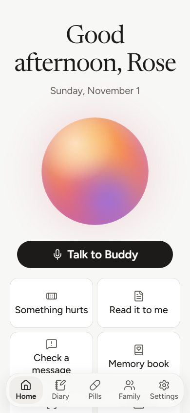 | 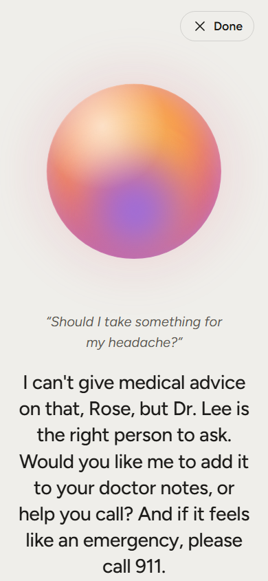 | 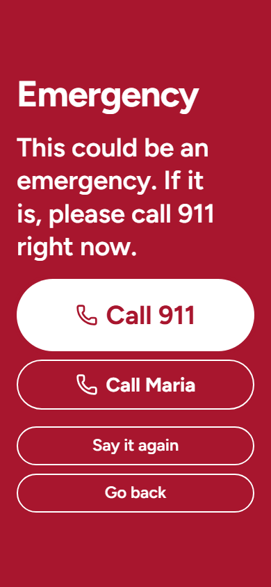 |

| Find my things | Read it to me | Check a message |
| --- | --- | --- |
| 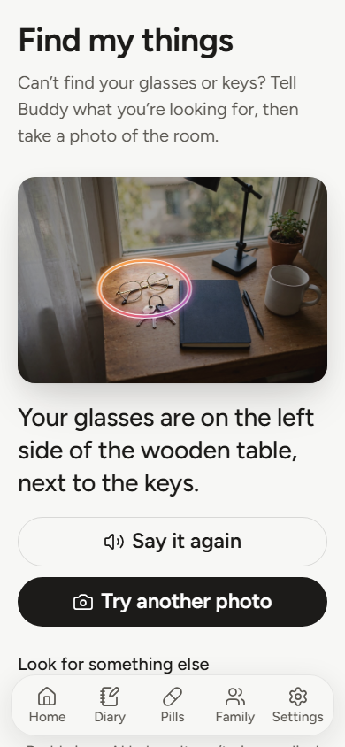 | 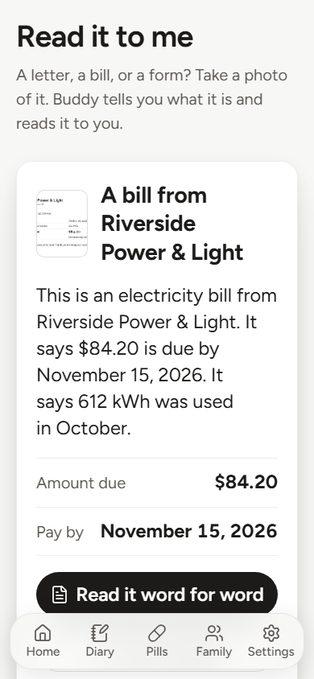 | 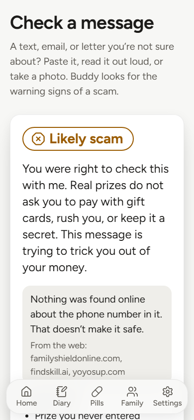 |

| Pills | Memory book | A page |
| --- | --- | --- |
| 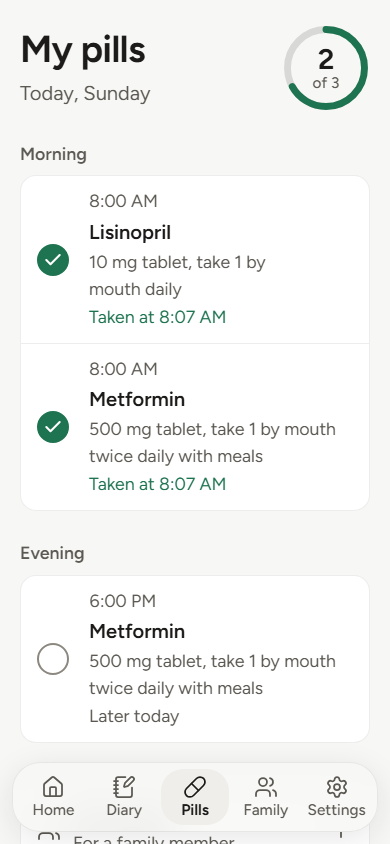 | 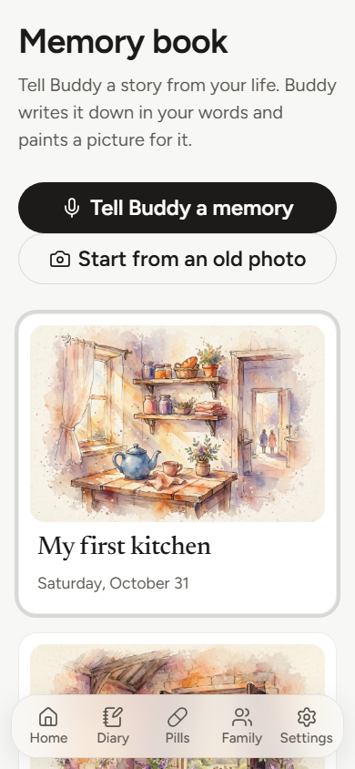 | 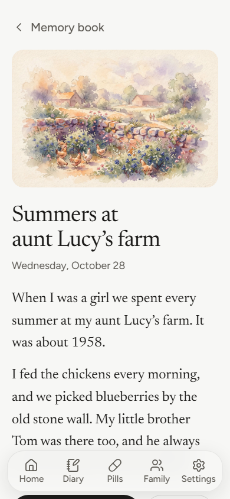 |

| Family screen | Doctor notes | Maria's page |
| --- | --- | --- |
| 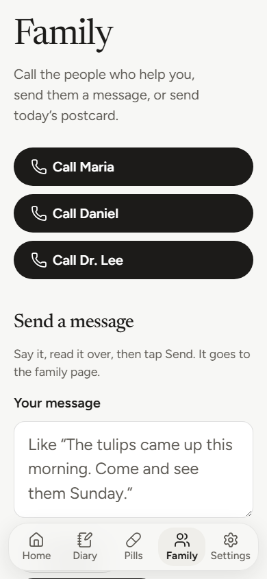 | 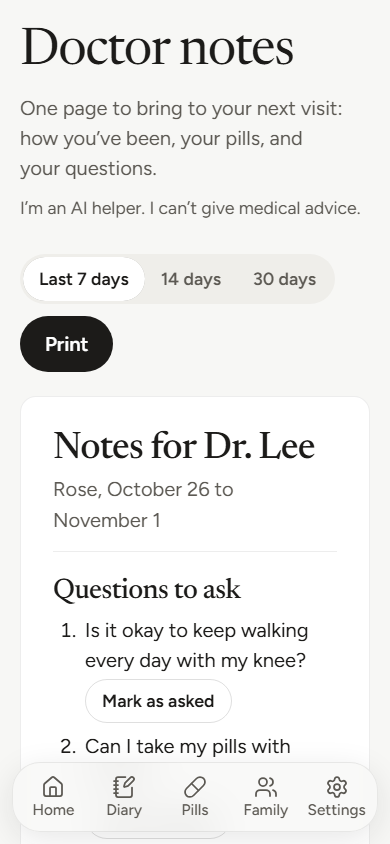 | 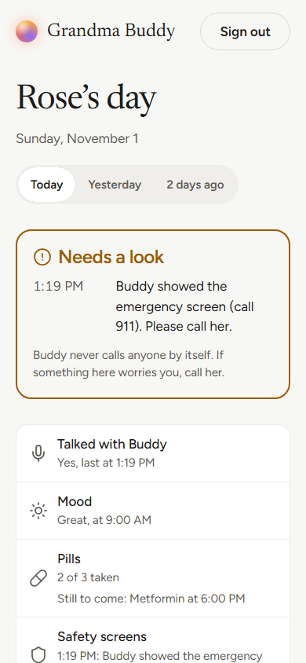 |

| The Today list | Home at desktop width |
| --- | --- |
| 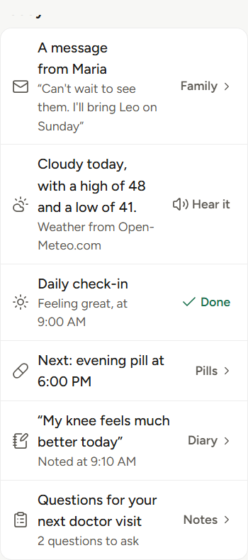 | 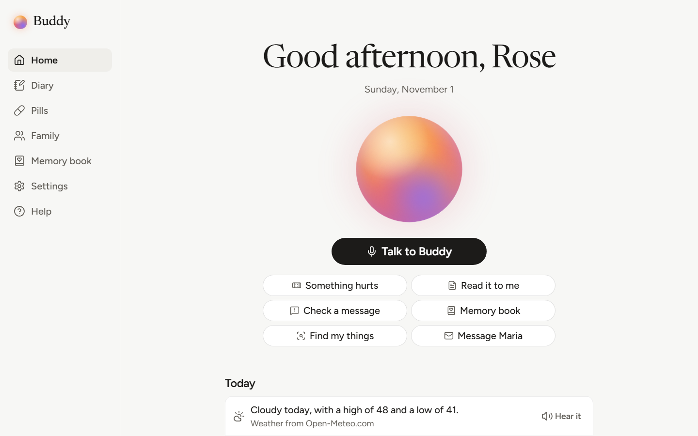 |

## What it does

- **She just talks.** One tap, then hands-free: her words appear as she says them, Buddy answers in a warm voice and big text, then listens again. It never listens while it is talking.
- **Daily check-in.** How she feels, whether anything hurts, whether she took her pills.
- **Symptom diary.** "Something hurts": up to three short questions, then it is written down in her own words.
- **Pill reminders.** Spoken, with the label exactly as her family typed it, "I took it" and "Remind me in 10 minutes". A family member can photograph the bottle to fill in the form, and checks each line against it before saving. A dose she never marks shows as "Not taken".
- **Companion.** A kind friend with a memory: her garden, her family, her shows, her old job. When she is lonely, it listens first, then suggests one real person to call.
- **Find my things.** "Where are my glasses?" plus a photo of the room: a glowing halo around them, and "on the side table, next to the lamp".
- **Read it to me.** A photo of a letter, a bill, or a form: what it is and what it says, or word for word, big on the screen. A letter about her health is only read, never explained.
- **Check a message.** A pasted text, a message read out loud, or a photo of one: Likely scam, Suspicious, or Looks safe, with the warning signs and what to do. A phone number or website in it is looked up on the web, and never read back to her.
- **Today's weather, news, and sports** for her town: the weather from Open-Meteo, in plain words, and a cheerful local story or the scores from Meta's web search, with where it read them.
- **Doctor visit notes.** The week's diary, pills, mood, and her questions on one printable page, grouped by topic.
- **Memory book.** She tells a story; it becomes a page in her words with a painting. She can start from an old photo. Photos with people in them are never repainted.
- **Message Maria, and a postcard a day.** She says a message, Buddy reads it back, one tap sends it (with her own voice) to the family page. Maria writes back, in writing or by voice. Once a day, one cheerful thing she said becomes a painted postcard.
- **The family page.** Her family joins with an invite code and sees her day: what needs a look, her mood, her pills, her diary, their messages, the postcard. She chooses what is shared. The Family plan runs on Stripe's test mode (nothing is ever charged); everything Buddy does for her is free.
- **Installs like an app.** "Install app" in Chrome or Edge puts the orb on her home screen, full screen, and it opens even when the server is down.
- **Her data is hers.** Export everything as one zip, or delete everything. Nothing leaves the computer except what each Meta model needs for that one task.

## How it uses Meta's models

Each model does the job it is best at, and plain Python rules check her words before any AI and Buddy's words after.

| Model | What it does here |
| --- | --- |
| **Muse Voice Transcribe 1.0**, realtime | Hears her live over Meta's realtime WebSocket in ENDPOINTING mode: her words stream back as she speaks, and Meta tells us when her turn is over, so she never taps. The key stays on our server, which relays her microphone. The same model, by file upload, writes down tap-to-talk recordings and a family member's voice message, with her pills' and family's names as keyword hints. |
| **Muse Spark 1.3** | The conversation and its 14 tools (function calling): diary entries, pills taken, doctor questions, facts to remember, opening a screen, the day's postcard pick. Structured outputs (strict JSON) for the scam verdict, doctor notes, Memory book pages, and what Buddy learns about her each day. Image input for a photo of a message, a letter or bill, a pill bottle, an old photo, and the room where she lost something (to say where it is in words). |
| **SAM 3.1** | Finds the thing she lost in her photo from a short phrase ("glasses"), so Buddy can draw a halo around it. Sent with `store=false`; her photo is never kept. |
| **Muse Image 1.0** | Paints one soft picture for each Memory book page and for the day's postcard (small faceless figures only, never a real likeness). |
| **Web search** (the Responses API's built-in tool, with Muse Spark) | A cheerful local story and sports for her town, with their sources shown; and whether a phone number or website in a suspicious message is a known scam. Only her town, or only the number, is sent. (The weather itself comes from Open-Meteo, no AI involved.) |

Every call lives in one file, `app/meta_client.py`. Standard models only: the app refuses to start with a `-contributor` model, so her conversations are never used for training.

## Safety by design

- **No medical, mental-health, or food advice, ever.** The prompt forbids it, and a second layer of plain rules (`app/guard.py`) checks every AI reply before she hears it: a dose, "you should rest", "probably nothing", a medicine she wasn't prescribed, or a breathing exercise is swapped for a fixed reply that points her to her doctor. When she asks for advice, Call doctor, Call family, and Add to doctor notes always appear.
- **The safety net runs first, with rules, not AI** (`app/safety.py`). Chest pain, trouble breathing, stroke signs, a fall, a double dose, thoughts of dying: a fixed full-screen message with big Call 911, Call Poison Control, or Call 988 buttons, before any AI call, even with the internet down. Checked with real spoken clips: "My chest hurts and I can't breathe" opens the emergency screen in 0.01 seconds with zero AI calls.
- **Record, remind, connect.** The diary keeps her own words. Reminders repeat the label exactly as her family entered it; the AI never sees a dose. The family update is written by plain code from the logs.
- **Privacy.** Her data stays in a SQLite file on her computer. Only Buddy's own page can use its API. Safety screens reach her family only as a kind and a time, never her words. Crisis words are never kept.

The rules are in `docs/SAFETY.md`; `tests/test_safety.py` covers every phrase in it.

## Built during the hackathon

This repository was created on October 26, 2026, the kickoff day. I planned the idea and set up my tools before the event; all of the app's code was written between October 26 and November 4, and the commit history shows it. The Day 1 skeleton (server, database, first screen) was made with Muse Code, Meta's coding agent; everything after that was built with Claude Code, from the plan in `docs/` and the instructions in `AGENTS.md` and `.claude/skills/`. The helper skills from other projects are credited in `THIRD_PARTY_NOTICES.md`, with the fonts, icons, the Kokoro voice, and the test photos.

## Run it (Windows)

You need Python 3.12 or newer, Chrome or Edge, and a Meta Model API key from [dev.meta.ai](https://dev.meta.ai).

**The short way:** double-click `start.bat`. The first time it makes the Python environment, installs the packages, and opens `.env` for your key; after that it loads the made-up demo week (only into an empty database), starts the server, and opens Buddy in your browser as soon as the server answers (double-clicking it again while Buddy runs just opens the browser). Close its window to stop Buddy.

**By hand,** in PowerShell, in the project folder:

```powershell
python -m venv .venv                                     # once: the project's Python environment
.venv\Scripts\python -m pip install -r requirements.txt  # once: the packages
.venv\Scripts\python -m pip install kokoro-onnx==0.6.1 --no-deps --ignore-requires-python  # once: Buddy's natural voice (optional)
.venv\Scripts\python scripts\get_voice.py                # once: the voice model, about 354 MB (optional)
.venv\Scripts\python scripts\seed_demo.py                # optional: the made-up demo week for "Rose", ending today, pictures included
.venv\Scripts\python -m uvicorn app.main:app --reload    # start the app
```

Before the first start, copy `.env.example` to `.env` and put your key on its `MODEL_API_KEY=` line. Then open http://localhost:8000 in Chrome or Edge and allow the microphone. http://localhost:8000/about is the landing page for the family member setting Buddy up; http://localhost:8000/family is the family page ("Try the demo as Maria" with the demo week loaded). To start the demo week over, run `scripts\seed_demo.py --reset` (a backup is saved first) or use Settings, Her data, "Reset the demo week". Without the natural voice, Buddy speaks with the browser's own voice (Edge has the warmest ones). An optional Stripe *test* key on the `STRIPE_SECRET_KEY=` line turns the family page's demo-mode plan into a real test-mode checkout; a live key refuses to start.

Start it once only. On Windows a second server on the same port starts without a word of complaint, and then both answer slowly (Buddy's voice took 7 seconds a sentence that way). If Buddy is already running, stop it first with Ctrl+C in its window; `start.bat` checks for this itself and just opens the browser.

## A live demo on the web

`docs/DEPLOY.md` has the click-by-click steps to put a public demo on Render from the `Dockerfile` and `render.yaml` here ($7 a month always on, or free with a minute's wake-up). It runs as a public demo (`PUBLIC_DEMO=1`): Rose's made-up week put back every night, a share of Buddy's thinking per visitor and a cap for the day so the key can't be drained, no sign-ups, and the key only as a host secret. The safety net never counts and is never stopped.

## Tests

```powershell
.venv\Scripts\python -m pytest                          # 800+ tests; Meta is always faked, no test can reach the internet
.venv\Scripts\python -m playwright install chromium     # once: the browser the checks below drive
.venv\Scripts\python scripts\browser_checks\home.py     # every screen and flow in a real browser, no key needed
.venv\Scripts\python scripts\check_failures.py         # every failure state (Meta down, no internet, a blocked microphone, a blurry photo, the server stopped), with screenshots
.venv\Scripts\python scripts\qa_screens.py             # every screen at 375, 768, and 1440px in light and dark, with the layout check (no key needed)
```

The `scripts\check_*.py` scripts each make a few real Meta calls by hand and say what they cost: `check_voice.py` sends six spoken clips through live and batch transcription and the whole chat pipeline (the safety net, the no-advice reply, the tools) with every call counted and timed; `check_photos.py` runs Find my things, Read it to me, and Check a message in a real browser with screenshots. `scripts\demo_screenshots.py` and `scripts\readme_screenshots.py` take every screen's picture from the demo data.

## What's next

- **Faster first words.** Buddy's first word now comes about 5 to 9 seconds after hers (it was 10 to 19): the page ends her turn itself about a second after her last word (Meta took up to 4.7 seconds), and what's left is Muse Spark's thinking (2 to 4 seconds a round, two rounds when a tool is used) and the voice (half a second). Streaming the model's words would help once Meta sends them as they are written.
- **Spanish and the other 24 languages** Voice Transcribe knows, with Buddy answering in hers.
- **Find my things from a slow video pan** of the room, with SAM's video tracking.
- **A second family member** on the family page, and a nightly summary by email.
- **A real phone app** around the same server, so Buddy is always one tap away.

## License

MIT. See `LICENSE`.
